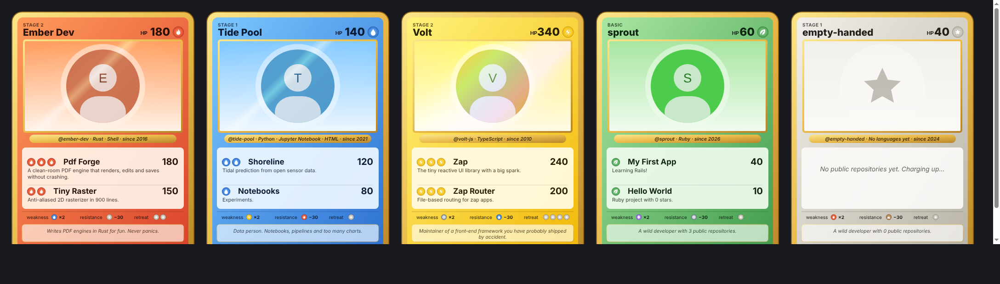

# holocard

Turn any GitHub profile into a collectible trading card you can drop into your README.

```md

```



## How a card is dealt

| On the card | Comes from |
|---|---|
| Type (Fire, Water, Electric, Steel, Grass, Prism, Earth, Normal) | Your top language, weighted by stars |
| HP | Followers, on a log scale (40 to 340) |
| Attacks | Your two most-starred repos; damage scales with stars, energy cost with forks |
| Stage | Account age: Basic, Stage 1 (2+ years), Stage 2 (6+ years) |
| Rarity | Total stars: Common, Uncommon (10), Rare (100), Holo Rare (1k), Legendary (10k) |
| Weakness / resistance | The type ring: each type is weak to the next one |
| Retreat | Public repo count |
| Flavor text | Your bio |

Rare cards and above get an animated holo foil; Legendary gets a rainbow one. Add `&animate=0` for a still card.

## Run it

Requires Node 22.18+ (TypeScript runs natively, no build step).

```sh
npm install        # dev tools only: typescript, @types/node
npm test
npm run samples    # renders test fixtures to samples/
npm run dev        # landing page + card endpoint on http://localhost:3000
HOLOCARD_FIXTURES=1 npm run dev   # same, with offline test profiles (ember-dev, volt-js, ...)
```

Deploy to Vercel as is: `functions/card.ts` (built to `/api/card` by `npm run build`) is a standard `Request -> Response` handler. Set `GITHUB_TOKEN` (no scopes needed) to raise GitHub's rate limit from 60 to 5,000 requests an hour. Responses are cached at the edge for six hours.

Errors still return a card image, so an embed never shows a broken icon.
